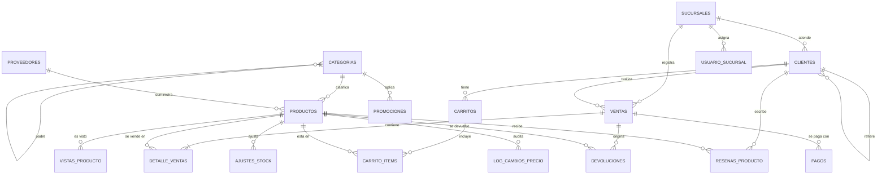

# Proyecto de Base de Datos para un E-commerce

Base de datos relacional en **MySQL 8.0** para una tienda en línea: catálogo, clientes, ventas, inventario, promociones, reportes y seguridad. El proyecto incluye esquema con datos de ejemplo, 20 consultas analíticas, 20 funciones, 20 triggers, 20 eventos programados, 20 procedimientos almacenados y 20 requisitos de seguridad.

> **Nota:** los nombres de consultas, funciones, triggers, eventos, procedimientos y requisitos de seguridad (salvo `fn_CalcularTotalVenta`, `trg_prevent_negative_stock`, `sp_ProcesarPago` y `sp_RealizarNuevaVenta`) son **propuestos**. Deben alinearse con la especificación oficial del curso antes de entregar. Los scripts **no se ejecutaron contra un servidor MySQL**: se validaron solo con revisión estática.

## Integrantes

- Andres Mauricio Lopez Quintero

## Requisitos

- **MySQL 8.0.19 o superior** (usa `FAILED_LOGIN_ATTEMPTS`, `PASSWORD_LOCK_TIME`, `JSON_TABLE`, CTE recursivas y funciones de ventana).
- Una cuenta administradora conectada por `localhost` (por ejemplo `root@localhost`) con privilegios para: crear bases de datos, usuarios y roles; `EVENT`; `SYSTEM_VARIABLES_ADMIN` y `PERSIST_RO_VARIABLES_ADMIN` (para `SET GLOBAL`/`SET PERSIST`).
- **`event_scheduler`** activo. `06_Eventos.sql` ejecuta `SET GLOBAL event_scheduler = ON`, que no persiste tras un reinicio; para persistirlo use `SET PERSIST event_scheduler = ON;` o `event_scheduler=ON` en `my.cnf`.
- Si el servidor tiene el registro binario activo, las funciones ya declaran `DETERMINISTIC` / `READS SQL DATA` / `NO SQL`, por lo que no hace falta `log_bin_trust_function_creators`.

## Instrucciones de Ejecución

**Orden obligatorio: `01, 02, 03, 05, 06, 07, 04`.** El archivo `04_Seguridad.sql` va al final porque sus `GRANT` requieren que ya existan `log_cambios_precio` (creada en 05), los procedimientos (07), las funciones (03) y las vistas (01). `05` usa funciones de `03`, y `07` usa funciones de `03` y depende del comportamiento de los triggers de `05`.

```bash
mysql -u root -p < 01_Esquema_y_Datos.sql
mysql -u root -p < 02_Consultas_Avanzadas.sql
mysql -u root -p < 03_Funciones.sql
mysql -u root -p < 05_Triggers.sql
mysql -u root -p < 06_Eventos.sql
mysql -u root -p < 07_Procedimientos_Almacenados.sql
mysql -u root -p < 04_Seguridad.sql
```

Todos los scripts son re-ejecutables. `01` recrea la base `ecommerce_db` completa (`DROP DATABASE IF EXISTS`), por lo que **borra los datos existentes**. Ejecute `04` conectado a `root@localhost`: elimina la cuenta `root@'%'`.

## Diagrama ER



## Contenido de los archivos

| Archivo | Contenido | Cantidad |
|---|---|---|
| `01_Esquema_y_Datos.sql` | 6 entidades principales, sucursales, tablas de soporte, vistas y datos de ejemplo | 6 entidades + soporte |
| `02_Consultas_Avanzadas.sql` | Consultas con CTE, ventanas (`RANK`, `NTILE`, `LAG`), cohortes, RFM y proyección | 20 |
| `03_Funciones.sql` | Funciones de cálculo, validación y consulta | 20 |
| `04_Seguridad.sql` | Roles, usuarios, permisos por columna, políticas de contraseña, acceso por sucursal | 20 |
| `05_Triggers.sql` | Reglas de negocio, auditoría y control de stock | 20 |
| `06_Eventos.sql` | Tareas horarias, diarias, semanales, mensuales y trimestral | 20 |
| `07_Procedimientos_Almacenados.sql` | Operaciones transaccionales de venta, pago, inventario y reportes | 20 |

## Decisiones y supuestos

1. **Columnas añadidas** (la especificación las requiere pero no las define): `productos` (`id_categoria` con default "General", `id_proveedor`, `peso`, `ubicacion`, `stock_minimo`, `fecha_modificacion`), `clientes` (`fecha_nacimiento`, `ciudad`, `region`, `id_sucursal`, `total_gastado`, `fecha_ultimo_pedido`, `referido_por`, `activo`), `ventas` (`id_cliente`, `id_sucursal`, `costo_envio`), `detalle_ventas` (`id_venta`, `id_producto`, `UNIQUE(id_venta, id_producto)`) y `categorias.id_categoria_padre`.
2. **Estados de venta:** `Pendiente, Pagado, Enviado, Entregado, Cancelado, Devuelto` (se añade `Pagado` porque `sp_ProcesarPago` lo necesita). Flujo permitido controlado por trigger.
3. **Moneda e impuestos:** todo en COP; precios con IVA incluido (19%); tasa fija 1 USD = 4000 COP.
4. **Envío por peso total:** ≤1 kg = 8.000; ≤5 kg = 15.000; ≤20 kg = 30.000; más de 20 kg = 50.000. `ventas.total` es la suma de las líneas y `costo_envio` se guarda aparte; el pago es `total + costo_envio`.
5. **Ingresos:** todos los cálculos excluyen ventas `Cancelado`. `total_gastado` también.
6. **Stock:** solo lo modifican el trigger 2 (al insertar una línea), el trigger 3 (al cancelar) y los procedimientos de ajuste y devolución. `sp_RealizarNuevaVenta` no toca el stock, para no contarlo dos veces.
7. **Líneas de venta inmutables:** no se pueden actualizar ni borrar (triggers 9 y 10), lo que mantiene coherentes total y stock.
8. **Datos semilla:** son históricos y su stock ya es neto. Cancelar una venta semilla restauraría unidades que nunca se descontaron; el evento de cancelación automática lo evita, pero una cancelación manual sí las restauraría.
9. **Objetos en `01`:** `v_info_clientes_basica`, `v_ventas_sucursal`, `v_clientes_sucursal` y `usuario_sucursal`, porque `04` solo debe contener seguridad.
10. **Seguridad:** `analyst_user` es una cuenta adicional (los límites de consultas son por cuenta, no por rol). Las contraseñas de `04` son placeholders con contraseña expirada de inmediato. El acceso por sucursal se implementa con vistas y `USER()` porque MySQL no tiene seguridad por fila nativa.
11. **Auditoría de logins fallidos:** requiere `audit_log` (Enterprise) o `CONNECTION_CONTROL` (Community); sin ellos solo queda el bloqueo tras 5 intentos. Está documentado en el requisito 17.
12. **Simulaciones:** `ev_diario_backup_simulado` y `ev_semanal_optimizar_tablas_simulado` solo dejan una alerta; el respaldo real se hace con `mysqldump`. `ranking_productos` emula una vista materializada.

## Pasos de verificación

```sql
USE ecommerce_db;
SELECT COUNT(*) AS tablas   FROM information_schema.TABLES   WHERE table_schema='ecommerce_db' AND table_type='BASE TABLE';
SELECT COUNT(*) AS funciones FROM information_schema.ROUTINES WHERE routine_schema='ecommerce_db' AND routine_type='FUNCTION';   -- 20
SELECT COUNT(*) AS procedimientos FROM information_schema.ROUTINES WHERE routine_schema='ecommerce_db' AND routine_type='PROCEDURE'; -- 20
SELECT COUNT(*) AS triggers FROM information_schema.TRIGGERS WHERE trigger_schema='ecommerce_db';   -- 20
SELECT COUNT(*) AS eventos  FROM information_schema.EVENTS   WHERE event_schema='ecommerce_db';     -- 20
SHOW VARIABLES LIKE 'event_scheduler';                                                              -- ON
SELECT COUNT(*) AS ventas FROM ventas;                                                              -- 320

-- Consistencia: debe devolver 0 filas
SELECT v.id_venta FROM ventas v JOIN detalle_ventas d ON d.id_venta = v.id_venta
 GROUP BY v.id_venta, v.total HAVING v.total <> SUM(d.cantidad * d.precio_unitario_congelado);

-- Prueba funcional de venta y pago
CALL sp_RealizarNuevaVenta(1, NULL, '[{"id_producto":9,"cantidad":2}]', @id, @total);
SELECT @id, @total;
```
